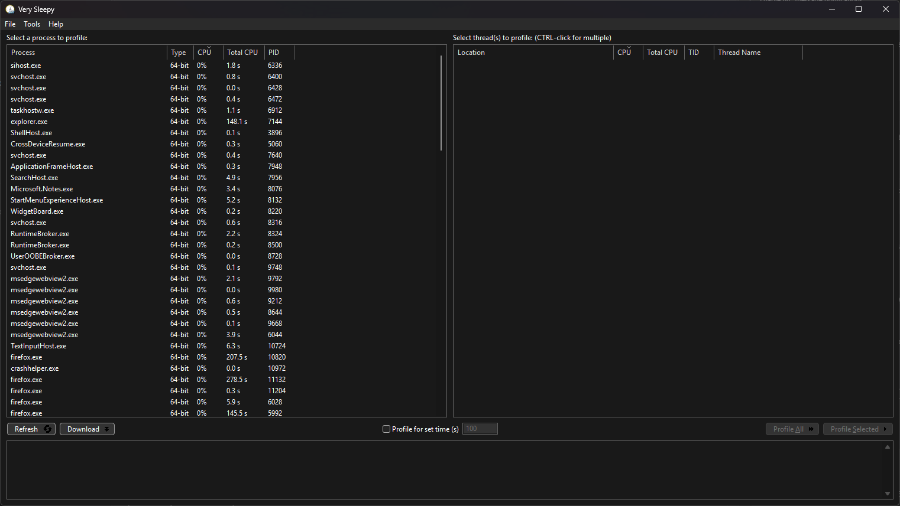

# Very Sleepy

[](https://github.com/oltolm/verysleepy/actions/workflows/build-windows.yml)

Very Sleepy is a sampling CPU profiler for Windows with a wxWidgets-based GUI. This repository is an actively developed fork of the [Very Sleepy project](https://github.com/VerySleepy/verysleepy).



## Features

* Profile an existing process, selected threads, or a program launched from Very Sleepy
* Resolve Microsoft PDB symbols through DbgHelp and the Microsoft Symbol Server
* Resolve MinGW DWARF symbols with the bundled, current [Dr. MinGW/MgwHelp fork](https://github.com/oltolm/drmingw), including substantially improved symbol and line information
* Export profiles as CSV, Callgrind, [speedscope](https://www.speedscope.app/) JSON, or folded stacks for flame graph viewers such as [flameshow](https://github.com/laixintao/flameshow) and [flamelens](https://github.com/YS-L/flamelens)
* Choose a light, dark, or system appearance; the modern palettes also apply to source and call-stack views
* Reopen captures quickly from the recent-files history and keep customized window and list layouts
* Filter samples by thread, inspect callers and callees, and jump from profiling results to source lines
* Use Very Sleepy from the [command line](https://github.com/VerySleepy/verysleepy/wiki/Command-Line-Usage), including captures launched from a console

## Documentation

The [upstream project wiki](https://github.com/VerySleepy/verysleepy/wiki) documents the inherited user interface and features, including [command-line operation](https://github.com/VerySleepy/verysleepy/wiki/Command-Line-Usage), [profiling MinGW programs](https://github.com/VerySleepy/verysleepy/wiki/Profiling-MinGW-Programs), and [late symbol resolution](https://github.com/VerySleepy/verysleepy/wiki/Late-Symbol-Resolution). Fork-specific changes are summarized below and in the [release notes](https://github.com/oltolm/verysleepy/releases).

## Download

Installers are available from this fork's [GitHub releases](https://github.com/oltolm/verysleepy/releases). The [Windows build workflow](https://github.com/oltolm/verysleepy/actions/workflows/build-windows.yml) also produces an installer artifact for current development builds.

## History

### This fork

#### Current development (after v100)

* Updated the bundled Dr. MinGW, MgwHelp, and dwarfstack code, adding much better DWARF symbol and line handling
* Reworked symbol loading to use one helper instance per target process and improved coexistence with the Microsoft DbgHelp runtime
* Reduced GUI list rebuilding and adopted VS Code's Modern light and dark palette colors
* Improved symbol diagnostics, call-stack comparisons, and runtime packaging

#### v92–v100 (2026)

* Published the first numbered releases of this fork, with reproducible CMake/NSIS packaging and automatic GitHub releases
* Added speedscope JSON and folded-stack exports for standalone flame graph viewers
* Added and refined recent-file history, persistent list columns, and dockable profiler layouts
* Fixed x64 call stacks and made symbol loading, module detection, and target suspension more reliable
* Added a dedicated console build so output from programs launched by the profiler can be redirected
* Improved profiling and GUI performance by caching symbol lookups and avoiding unnecessary list reconstruction

See the [v92 through v100 releases](https://github.com/oltolm/verysleepy/releases) for the detailed changes in each release.

#### 2023–2025

* Started this fork from upstream commit `dcec532`
* Replaced the legacy build with CMake and added GCC/MSYS2 support
* Updated the application for wxWidgets 3.3 and modernized its wxWidgets and C++ usage
* Added recent profile history and selectable light, dark, and system themes
* Added the original speedscope exporter and numerous process-, thread-, and call-stack-view performance improvements
* Simplified the codebase and made the maintained build 64-bit only

### Inherited upstream history

#### Version 0.92 (unfinished upstream development)

* Do not include time while paused in sample durations
* Add command-line switch `/d` to wait before starting profiler
* Contributed by [aaalexandrov](https://github.com/aaalexandrov):
  * Add sample filtering by thread ([#86](https://github.com/VerySleepy/verysleepy/pull/86))
  * Profile new threads as they are created ([#88](https://github.com/VerySleepy/verysleepy/pull/88))

#### Version 0.91 (2021-08-19)

* Rename project back to Very Sleepy (that fork repository became the official upstream repository)
* Use [Dr. MinGW](https://github.com/jrfonseca/drmingw) to resolve MinGW symbols by default
* Update Wine DbgHelp for Windows
* Improve and greatly simplify the build process ([#40](https://github.com/VerySleepy/verysleepy/pull/40))
* Add continuous integration via AppVeyor
* Improve Visual Studio 2015 support ([#28](https://github.com/VerySleepy/verysleepy/issues/28))
* More user interface fixes and improvements
* Contributed by [Bernat Muñoz Garcia](https://github.com/shashClp):
  * Use Scintilla for syntax highlighting ([#16](https://github.com/VerySleepy/verysleepy/pull/16))
* Contributed by [Ashod](https://github.com/Ashod):
  * 64-bit fixes ([#21](https://github.com/VerySleepy/verysleepy/pull/21))
* Contributed by [k4hvd1](https://github.com/k4hvd1):
  * Added command-line option `/a` to profile an existing process by its process ID ([#30](https://github.com/VerySleepy/verysleepy/pull/30))
* Contributed by [Markus Gaisbauer](https://github.com/quijote):
  * Added "Total CPU time" column ([#37](https://github.com/VerySleepy/verysleepy/pull/37))
  * Improved handling of processes with many threads ([#38](https://github.com/VerySleepy/verysleepy/pull/38))
* Contributed by [Bernhard Schelling](https://github.com/schellingb):
  * Added Callgrind-format export ([#46](https://github.com/VerySleepy/verysleepy/pull/46))
  * Fixed symbols (PDB files) not being unloaded after detaching ([#57](https://github.com/VerySleepy/verysleepy/pull/57))
  * Improved jumping to source lines from list views ([#58](https://github.com/VerySleepy/verysleepy/pull/58))
* Contributed by [rammerchoi](https://github.com/RammerChoi):
  * Added command-line switches `/mt` and `/mbt` ([#48](https://github.com/VerySleepy/verysleepy/pull/48))
* Contributed by [Graeme Kelly](https://github.com/graemekelly):
  * Added display of thread names in thread lists ([#60](https://github.com/VerySleepy/verysleepy/pull/60))
  * Added column headers to exported CSV files ([#62](https://github.com/VerySleepy/verysleepy/pull/62))
* Contributed by [Yujiang Wang](https://github.com/AlanIWBFT):
  * Fixed missing buttons for very long paths ([#65](https://github.com/VerySleepy/verysleepy/pull/65))
  * Updated DbgHelp to 10.0.17763.1 ([#65](https://github.com/VerySleepy/verysleepy/pull/65))
* Contributed by [djdron](https://github.com/djdron):
  * Improved HiDPI support ([#74](https://github.com/VerySleepy/verysleepy/pull/74))
  * Fixed some memory leaks ([#75](https://github.com/VerySleepy/verysleepy/pull/75))
  * Updated Dr. MinGW ([#77](https://github.com/VerySleepy/verysleepy/pull/77))

#### Version 0.90 (2014-12-23)

* Redesign parts of the file format and internal database representation to allow more exact late symbol loading and a future disassembler view
* Add an "Address" column to all function lists
  * For the call-stack and callers view, the address specifies the address past the call instruction
* Several fixes to the crash reporter
* Use wxWidgets 2.9.5
* Fix problems caused by `dbghelp.dll` hijacking
* Fix handling of symbols containing whitespace characters
* More user interface improvements
* Contributed by [Unknown W. Brackets](https://github.com/unknownbrackets):
  * 64-bit fixes ([#6](https://github.com/VerySleepy/verysleepy/pull/6))
* Contributed by Michael Vance:
  * Add CSV export for the call-stack view
  * UI fixes and code cleanup

#### Version 0.83 (2013-08-22)

* Rename fork to "Very Sleepy CS"
* Numerous user interface performance, responsiveness, and usability improvements
* Allow specifying additional symbol search paths
* Add Back and Forward menu items and hotkeys for function-list navigation
* Improve overall performance
* Add late symbol loading by saving a minidump during profiling
* Install the 32-bit version alongside the 64-bit version
* Contributed by [Richard Munn](https://github.com/benjymous):
  * Added a time-limit option to the interface ([#1](https://github.com/VerySleepy/verysleepy/pull/1))
  * Added function highlighting and filtering ([#2](https://github.com/VerySleepy/verysleepy/pull/2))
  * Interface improvements ([#3](https://github.com/VerySleepy/verysleepy/pull/3))

#### [First upstream fork release](https://blog.cy.md/2013/01/11/very-sleepy-fork/) (2013-01-11)

* GitHub repository created
* Fix several issues with the `/r` command-line option
* Various UI improvements
* Do not completely abort after one failed `GetThreadContext` call

Changes before the repository's creation are available in its Git history.

## Building

### Prerequisites

* [CMake](https://cmake.org/) 3.21 or newer
* MSYS2 UCRT64 with Ninja, GCC, wxWidgets 3.3, and [NSIS](https://nsis.sourceforge.io/)

Third-party dependencies are Git submodules. Clone with `--recursive`, or initialize them after cloning:

```sh
git submodule update --init --recursive
```

Configure the `gcc64` preset in an MSYS2 UCRT64 shell and build the package target:

```sh
cmake --preset gcc64
cmake --build --preset gcc64 --config Release --target package
```

The NSIS installer is written to `build-gcc64/packages/`.

## Contributing

Bug reports and feature requests are welcome in this fork's [issue tracker](https://github.com/oltolm/verysleepy/issues). Please submit code changes as [pull requests](https://github.com/oltolm/verysleepy/pulls).
